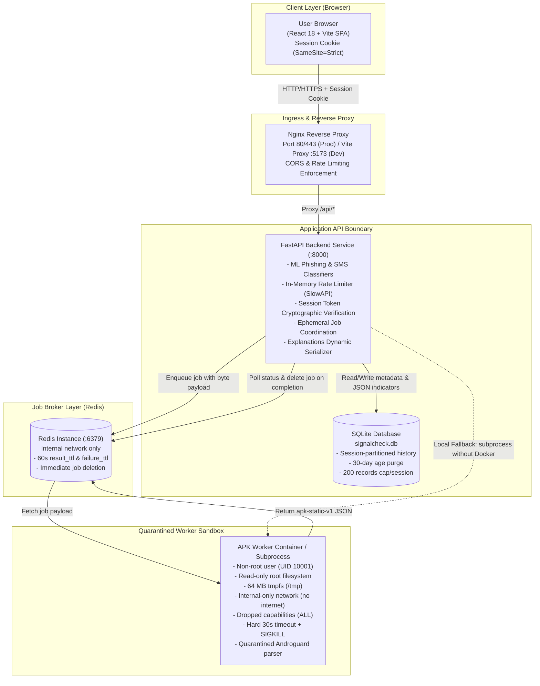

# SignalCheck System Architecture & Isolation Model

> [!NOTE]
> **Android Architecture Update (Milestone 1.0):**
> The live user-facing APK static analysis upload subsystem, SQLite database persistence, and asynchronous worker queue have been decommissioned. The product runtime operates completely stateless, providing production ML endpoints for Web Phishing, SMS Smishing, and the offline Android 226-Feature Benchmark. The C5 static analysis heuristic evaluation pipeline has been relocated to `backend/eval/` for offline research use.

SignalCheck is an accessible cybersecurity awareness and research platform designed to evaluate suspicious electronic communications (web phishing, SMS smishing) and precomputed mobile indicators (Android 226-feature vector benchmark).

---

## 1. High-Level System Architecture

The diagram below illustrates the end-to-end architecture, network boundaries, and execution boundaries:

---

## 2. Core Architectural Components

### 1. Client Browser (Frontend)
- **Framework:** React 18, Tailwind CSS, Lucide icons, Vite.
- **Access Control & Privacy:** On first analysis, an anonymous, random `session_token` cookie is set (`httpOnly`, `SameSite=Strict`, `Secure` in production). The browser sends this cookie on subsequent requests to isolate analysis history without requiring user accounts or registration.

### 2. Ingress & API Gateway (Nginx / Vite Dev Proxy)
- In container deployments, **Nginx** handles TLS termination, reverse proxy routing (`/api/*` to FastAPI, `/` to static frontend build), and security headers (`X-Frame-Options`, `Content-Security-Policy`).
- In local development without Docker, Vite dev server proxies `/api` requests from `http://127.0.0.1:5173/api` to `http://127.0.0.1:8000/api`.

### 3. FastAPI Backend
- **Stateless Inference:** Operates frozen scikit-learn models (Domain-Grouped TF-IDF for phishing, SMS-05-C FeatureUnion for smishing) verified against SHA-256 integrity manifests at startup.
- **Safe APK Ingestion:** Performs pre-parse validation (magic bytes `PK\x03\x04`, 25 MB size cap, zip-bomb compression ratios, path-traversal checks) before handing bytes to the worker.
- **Never Imports Androguard:** The API process has zero dependency on Androguard, preventing decompiler exploits from compromising API availability.
- **Dynamic Educational Explanations:** Attaches rich educational guidance (`what_it_means`, `why_attackers_use_it`, `legit_uses`, `what_to_do`) dynamically at serialization time by rule ID.

### 4. Job Broker (Redis & RQ)
- Decouples untrusted binary parsing from synchronous HTTP threads.
- Jobs are assigned a strict 60-second `result_ttl` and `failure_ttl`.
- Immediate purge: As soon as the terminal state is fetched via `GET /api/apk/jobs/{id}`, the backend caches the result briefly in memory and deletes the job (`job.delete()`) from Redis.

### 5. Quarantined APK Worker
- **Parsing Quarantine:** Only the worker module (`app.apk_worker`) imports and runs Androguard.
- **Container Hardening (Linux CI / Production):**
  - Runs as non-root UID `10001:10001`.
  - Immutable filesystem (`read_only: true`).
  - Ephemeral scratch space limited to a 64 MB memory tmpfs at `/tmp` (`noexec,nosuid,nodev`).
  - No internet access (`internal: true` Docker network; outbound sockets fail with `Network is unreachable`).
  - All Linux capabilities dropped (`cap_drop: ALL`, `no-new-privileges: true`).
  - Hard 30-second execution deadline.
- **Subprocess Fallback (Windows Native Dev):**
  - Spawns an isolated Python child process (`sys.executable -m app.apk_worker`) under hard 30s timeout with process kill, allowing full functionality without Docker Desktop.

### 6. Persistence & Privacy (SQLite)
- Persists only `apk-static-v1` JSON results, package names, file sizes, SHA-256 digests, and session hashes.
- **Never Stores Binary Artifacts:** Uploaded APK binaries and bytecode slices are never persisted to the database.
- **Retention Controls:**
  - Per-session retention cap: max 200 records per session hash.
  - Age-based purge: records older than 30 days (`SIGNALCHECK_APK_HISTORY_MAX_AGE_DAYS`) are automatically purged on application startup and on each record insertion.
